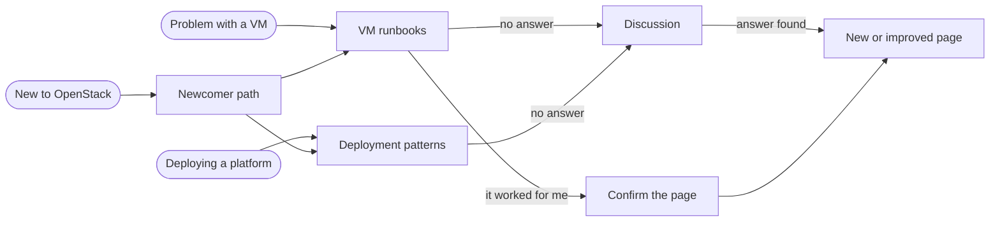

# OzarLand

**OpenStack operators sharing what they learn in production: fixes, deployment choices, experience.**
Open to everyone, whatever tool deployed your cloud.

## Where to start?

| You are… | Go to |
|---|---|
| 🌱 **New to OpenStack** | [Newcomer path](newcomers/README.md): five short pages, read in order |
| 🔧 **Fixing a problem with a VM** | [VM runbooks](https://github.com/OzarLand/openstack-vm-runbooks#index): find your symptom |
| 🏗️ **Deploying a platform** | [Deployment patterns](https://github.com/OzarLand/kolla-ansible-deployment-patterns#index): how others built theirs |
| 🤝 **Ready to contribute** | [Your first contribution](newcomers/first-contribution.md): start with ten minutes |

Nothing matches, or a question? [Start a discussion](newcomers/start-a-discussion.md).

## How it fits together

## What makes a page trustworthy

- It says **where it was observed**: OpenStack release, components, deployment method.
- It says **how much it was checked**: `draft`, then `lab-verified`, then `validated` by another operator.
  See the [knowledge lifecycle](docs/knowledge-lifecycle.md).
- Commands that change things are marked ⚠️, destructive ones 🛑.
- No secrets, real hostnames or addresses, ever.

## Repositories

| Repository | What it holds |
|---|---|
| [openstack-vm-runbooks](https://github.com/OzarLand/openstack-vm-runbooks) | Symptom-driven runbooks for instance problems |
| [kolla-ansible-deployment-patterns](https://github.com/OzarLand/kolla-ansible-deployment-patterns) | How operators deploy with Kolla-Ansible, and what each choice implies |
| `ozarland` (here) | The newcomer path, the community rules, the templates, the [Discussions](https://github.com/OzarLand/ozarland/discussions) |

Status, planned and archived repositories: [current repositories](docs/repositories.md#current-repositories).

## Learn more

- [Mission, principles and who OzarLand is for](docs/vision.md)
- [What you will find, and how repositories are organised](docs/repositories.md)
- [How to contribute](CONTRIBUTING.md), short on purpose
- [Content conventions](docs/conventions/README.md) and [shared templates](community/README.md)
- [Glossary](newcomers/glossary.md)
- [Governance](docs/governance.md), [agents](docs/agents.md) and the [review and merge policy](docs/review-policy.md)
- [GitHub conventions](docs/github-conventions.md), [decision records](docs/adr/README.md), [launch plan](docs/launch-plan.md)

## License

Apache License 2.0 for all content ([LICENSE](LICENSE), [licensing](docs/conventions/licensing.md)). OzarLand is an
independent community initiative, not affiliated with or endorsed by the OpenInfra Foundation or any vendor.
