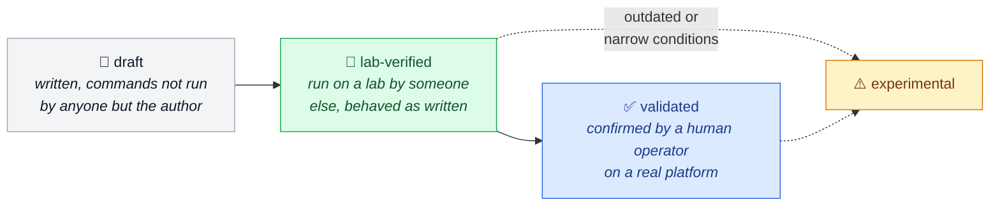
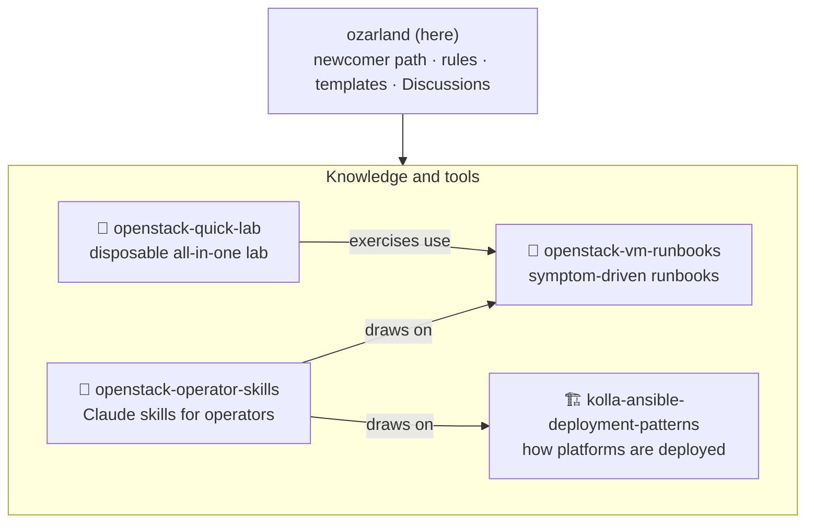
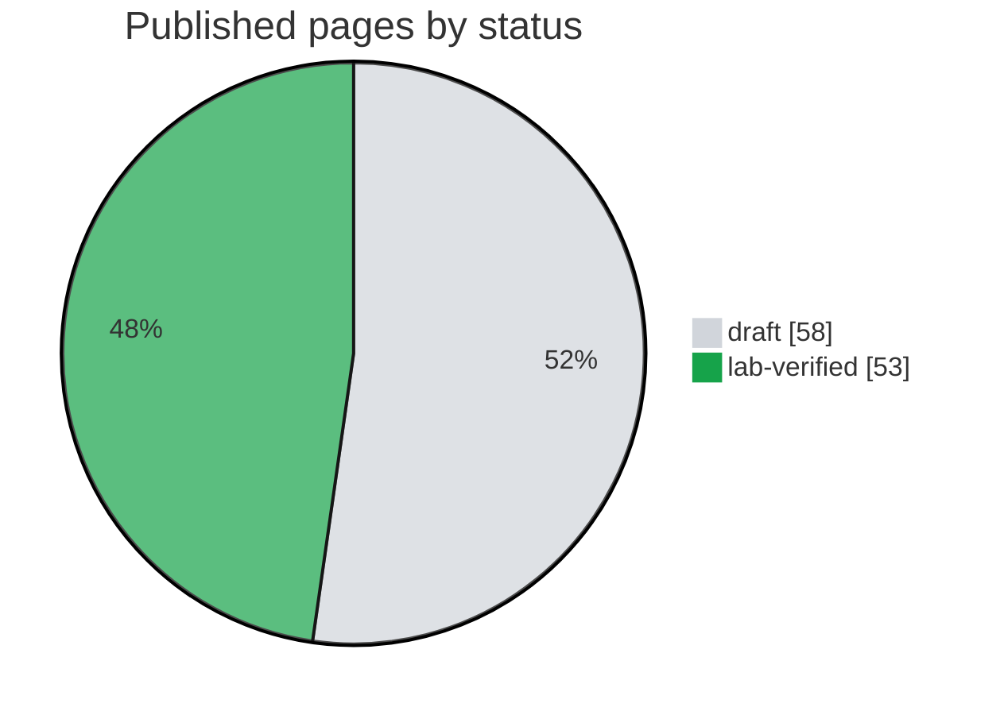

# OzarLand

**What OpenStack operators learn running it: fixes, deployment choices, experience.**

  
<!-- status-badges:start -->
  
  
  
  
<!-- status-badges:end -->
  
  

  <a href="#-where-to-start"><b>Start</b></a> ·
  <a href="#-what-makes-a-page-trustworthy"><b>Trust</b></a> ·
  <a href="#-repositories"><b>Repositories</b></a> ·
  <a href="#-project-status"><b>Status</b></a> ·
  <a href="CONTRIBUTING.md"><b>Contribute</b></a>

---

- 🧭 **Open to everyone**, whatever tool deployed your cloud.
- 🔎 **Every page names its source:** a failure reproduced on a lab, the maintainer's book, or upstream
  documentation and release notes.
- 🤖 **[When AI meets OpenStack](docs/how-ozarland-is-built.md):** AI agents write, review and lab-test pages;
  people decide and confirm.

## 🚀 Where to start

| You are… | Go to |
|---|---|
| 🌱 **New to OpenStack** | [Newcomer path](newcomers/README.md): five short pages, read in order |
| 🧪 **Want to try OpenStack** | [openstack-quick-lab](https://github.com/OzarLand/openstack-quick-lab): one VM, about one hour, one command to delete it |
| 🔧 **Fixing a problem with a VM** | [VM runbooks](https://github.com/OzarLand/openstack-vm-runbooks#index): step-by-step guides to diagnose and fix a known problem; find your symptom |
| 🏗️ **Deploying a platform** | [Deployment patterns](https://github.com/OzarLand/kolla-ansible-deployment-patterns#index): how platforms are built with Kolla-Ansible, today from lab deployments, and what each choice implies |
| 🤖 **Using an AI assistant on call** | [openstack-operator-skills](https://github.com/OzarLand/openstack-operator-skills): Claude skills that apply this knowledge and say how well each procedure was tested |
| 🤝 **Ready to contribute** | [Your first contribution](newcomers/first-contribution.md): start with ten minutes |

💬 Nothing matches, or a question? [Start a discussion](newcomers/start-a-discussion.md) (the public
question-and-answer forum of this repository).

## 🔬 What makes a page trustworthy

Every page says **where it was observed** (OpenStack release, components, deployment method) and **how much it
was checked**, with one of four statuses ([knowledge lifecycle](docs/knowledge-lifecycle.md)):

<b>The four statuses, word for word</b>

| Status | What it means |
|---|---|
| `draft` | Written; its commands have not been run by anyone other than the author. |
| `lab-verified` | Its commands were run on a lab by someone other than the author, on the release stated in the page, and behaved as the page says. |
| `validated` | Confirmed by a human operator, other than the author, on a real platform. |
| `experimental` | Possibly outdated, or confirmed only under narrow conditions. |

How many pages carry each status today: [page statuses](docs/knowledge-lifecycle.md#page-statuses).

| | Also on every page |
|:-:|---|
| ⚠️ 🛑 | Commands that change things are marked ⚠️, destructive ones 🛑 |
| 🔒 | No secrets, real hostnames or addresses, or unredacted logs, ever |
| 👥 | Written and lab-tested with AI agents, reviewed independently, validated only by human operators: [how OzarLand is built](docs/how-ozarland-is-built.md) |

## 🗺️ Repositories

| Repository | What it holds |
|---|---|
| 🔧 [openstack-vm-runbooks](https://github.com/OzarLand/openstack-vm-runbooks) | Symptom-driven runbooks for instance problems |
| 🏗️ [kolla-ansible-deployment-patterns](https://github.com/OzarLand/kolla-ansible-deployment-patterns) | How operators deploy with Kolla-Ansible (one of the common tools that install OpenStack), and what each choice implies |
| 🧪 [openstack-quick-lab](https://github.com/OzarLand/openstack-quick-lab) | A disposable all-in-one OpenStack on one VM, with exercises that use the runbooks |
| 🤖 [openstack-operator-skills](https://github.com/OzarLand/openstack-operator-skills) | Agent skills for Claude that bring the runbooks, deployment patterns and an operating method into incident analysis, change review and troubleshooting, with the validation status of every procedure |
| `ozarland` (here) | The newcomer path, the community rules, the templates, the [Discussions](https://github.com/OzarLand/ozarland/discussions) |

Status, planned and archived repositories: [current repositories](docs/repositories.md#current-repositories).

## 📊 Project status

<!-- status-progress:start -->
111 pages are published: 72 in the VM runbooks (runbooks and log-reading guides) and 39 in the deployment patterns.

| Repository | Progress | Lab-verified or validated |
|---|---|---:|
| 🔧 VM runbooks | 🟩🟩🟩🟩🟩🟩⬜⬜⬜⬜ | 44 / 72 |
| 🏗️ Deployment patterns | 🟩🟩⬜⬜⬜⬜⬜⬜⬜⬜ | 9 / 39 |

🟩 lab-verified · ⬜ draft · one square is about 10 % of the repository's pages
<!-- status-progress:end -->
> [!WARNING]
> None is `validated` yet: no human operator other than the author has confirmed a page on a real platform. Lab
> verification is run by an AI lab agent, not by a person. Read every page as a well-documented lead, not as a
> proven procedure, and check its *Validity and limits* section.

## 🚫 What OzarLand does not do

| | |
|:-:|---|
| ❌ | Recommend one way, one tool or one architecture to run OpenStack |
| ❌ | Certify procedures: "validated" means confirmed by operators, nothing more |
| ❌ | Replace the upstream OpenStack documentation; it adds operational experience and links to it |
| ❌ | Act as a support service: people help each other when they can |

More in [mission and principles](docs/vision.md).

## 👤 Who is behind OzarLand

OzarLand was started in October 2026 by Soufian Zaouam, OpenStack operator and author of
[*OpenStack, the Day After Tomorrow*](https://github.com/soufian-zaouam/openstack-the-day-after-tomorrow), from which
many runbooks are drawn. Today it is built by its maintainer with AI agents
([When AI meets OpenStack](docs/how-ozarland-is-built.md)). Run in a personal capacity; no vendor funds or directs
OzarLand.

> [!TIP]
> Corrections, confirmations of a page on your platform and questions are welcome now; wider contributions will
> open once the knowledge base is ready.

## 📚 Learn more

| 🧭 Understand | 🛠️ Contribute | ⚖️ How it is run |
|---|---|---|
| [Mission, principles and who OzarLand is for](docs/vision.md) | [How to contribute](CONTRIBUTING.md), short on purpose | [Governance](docs/governance.md) |
| [What you will find, and how repositories are organised](docs/repositories.md) | [Content conventions](docs/conventions/README.md) | [Agents](docs/agents.md) and the [review and merge policy](docs/review-policy.md) |
| [Glossary](newcomers/glossary.md) | [Shared templates](community/README.md) | [GitHub conventions](docs/github-conventions.md) and [decision records](docs/adr/README.md) |

## ⚖️ License

Apache License 2.0 for all content ([LICENSE](LICENSE), [licensing](docs/conventions/licensing.md)). OzarLand is an
independent community initiative, not affiliated with or endorsed by the OpenInfra Foundation or any vendor.
