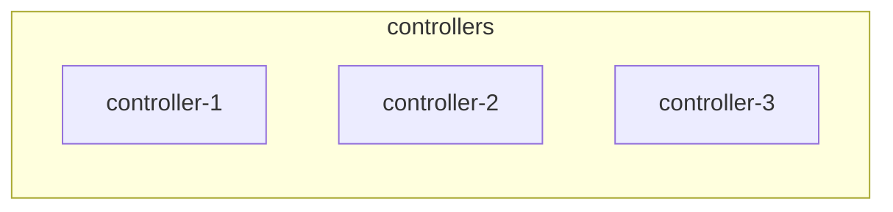

# <Pattern name>

## Context

<!-- The situation this pattern answers: purpose of the platform, constraints (budget, hardware, skills, SLA), what mattered most. Without this, the pattern cannot be compared to others. -->

## Topology

<!-- Roles, node counts, what runs where. A Mermaid or ASCII diagram with generic names (controller-1, compute-N). -->



## Network design

<!-- Interfaces and networks (management, API/VIP, tunnel/overlay, external/provider, storage, storage replication), MTU, bonding, VLANs. RFC 5737 addresses only. -->

## Storage design

<!-- Backends for Glance, Cinder, Nova ephemeral; replication; what is shared and what is local. -->

## Inventory and configuration layout

<!-- How the Kolla-Ansible inventory, globals.yml and config overrides are organised; how environments (lab, pre-prod, prod) are kept apart; how secrets (passwords.yml) are handled. Show the structure, not the values. -->

```text
inventory/
  production/
    hosts
    group_vars/
```

## Key choices and their consequences

<!-- One row per decision that someone else might make differently. -->

| Choice | Alternative(s) | Why this one here | Consequence in operation |
|---|---|---|---|
| | | | |

## What went wrong during deployment

<!-- Errors met, their cause, what fixed them. Link to runbooks when they exist. -->

## Version notes

<!-- Differences observed between Kolla-Ansible / OpenStack releases that affect this pattern; precautions. -->

## Lessons learned

<!-- What you would keep, what you would change, what you would warn someone else about. -->

## Validity and limits

<!-- Where this runs, for how long, what was not tried. This is one team's pattern, not a recommendation. -->

## Related

<!-- Other patterns to compare with, discussions, upstream docs. -->
