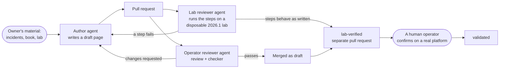

# How OzarLand is built: people and AI agents

OzarLand is written with the help of AI agents. This page says what they do, what stops them from publishing
something wrong, what they made possible so far, and where their limits are. The figures were counted in the
repositories on 2026-10-23.

## Who does what

| Who | Does | Never does |
|---|---|---|
| **The owner** (a person) | Provides the source material: incidents from production, the book *OpenStack, the Day After Tomorrow*, lab platforms. Decides the rules. Validates the risky changes: rules and agent roles, the checker, licence and policy files, page deletions, GitHub settings. Signs off every commit and takes responsibility for it ([DCO](https://developercertificate.org/)) | |
| **Author agent** | Writes runbooks and deployment pages from that material and opens pull requests | Confirms its own pages |
| **Documentation agent** | Writes and clarifies the community pages of `ozarland` | Reviews or merges |
| **Operator reviewer agent** | Reviews each pull request as an experienced operator, runs the [content checker](../tools/check_content.py), merges what passes without reservation, escalates the rest | Reviews a pull request it wrote |
| **Lab reviewer agent** | Runs the steps of a page on a disposable OpenStack lab and reports, step by step, what ran as written, what needed a change and what failed | Confirms a page it wrote |
| **Manager agent** | Tells the owner where things stand and passes on the owner's decisions | Writes, reviews or merges |
| **Human operators** (you) | Confirm a page on their own platform, report a difference, ask and answer in the Discussions | |

The agents and their rules are listed in [agents](agents.md). The [review and merge policy](review-policy.md) applies
to agents and people alike.

## The flow

## The safeguards

- **Independent review.** Every pull request is reviewed by an agent or a person other than its author. The
  `Author:` line of a pull request names the agent that wrote it, so that no agent reviews or merges its own work.
- **Runs on a real OpenStack.** The lab reviewer runs the commands on a disposable Kolla-Ansible lab with OpenStack
  2026.1, including the failures a runbook describes, and records every step's result in the pull request.
- **Statuses that say how far a page was checked.** A new page is `draft`. A page whose steps ran as written on the
  lab becomes `lab-verified`. Only a **human operator**, confirming it on another platform, makes it `validated`. See
  the [knowledge lifecycle](knowledge-lifecycle.md).
- **Sensitive data rules** apply to agents as to people: no secrets, real hostnames, addresses or unredacted logs
  ([sensitive data](conventions/sensitive-data.md)). The checker looks for addresses and secrets in every pull
  request.
- **The owner keeps the risky decisions**, listed in the [review and merge policy](review-policy.md).

## What the agents made possible

Counted on 2026-10-23, five days after the first content repository was created:

- **33 pages**: 25 runbooks in [openstack-vm-runbooks](https://github.com/OzarLand/openstack-vm-runbooks#index) and 8
  pages in [kolla-ansible-deployment-patterns](https://github.com/OzarLand/kolla-ansible-deployment-patterns#index).
- **12 runbooks `lab-verified`**: their steps ran as written on the lab.
- **39 lab reports and 40 operator reviews** on the pull requests of the two content repositories.
- **At least 10 steps that failed or needed a change** when the lab ran them as written. Each one is recorded in its
  pull request. For example:
  - `docker exec openvswitch_db ovs-appctl -t ovs-vswitchd version` fails on Kolla-Ansible 2026.1 with a stale
    pidfile while ovs-vswitchd is running. A reader would have concluded that a healthy switch was down. Fixed: the
    pages now run `ovs-appctl` in the `openvswitch_vswitchd` container.
  - `openstack port list` has no `device_id` column and refuses it. Fixed: the check now uses `port show`.
  - `openstack port list` also has no `Binding Host` or `VNIC Type` column; the client drops them silently, so the
    check prints less than it seems to. **Not fixed yet** in two runbooks (the `vif_plugging_timeout` and the
    maintenance pages).
  - On Kolla-Ansible 2026.1, `docker stop` is undone within about a minute, because each container runs from a
    systemd unit with `Restart=always`: the unit must be stopped instead. **Not fixed yet** in the runbook on
    reopening provisioning after an incident.

  Errors found but not yet fixed are the normal state of a knowledge base under review. They are listed here so that
  this page does not claim more than was done.
- **Behaviour observed on 2026.1, not assumed.** Neutron refuses with a 409 to remove a router's path while a
  floating IP depends on it, and refuses to associate a floating IP with no path (`not reachable from subnet`). The
  [unreachable-from-outside runbook](https://github.com/OzarLand/openstack-vm-runbooks/blob/main/networking/instance-unreachable-from-outside.md)
  was corrected to match.
- **A full upgrade, measured.** A Kolla-Ansible all-in-one lab went from 2025.1 to 2026.1. `kolla-ansible upgrade`
  ran in 24 minutes with no failed task. The running instances never stopped (same qemu processes before and after),
  and each floating IP lost about 2 s of traffic when the Open vSwitch container was recreated. The
  [upgrade report](https://github.com/OzarLand/kolla-ansible-deployment-patterns/blob/main/version-notes/upgrade-report-2025.1-to-2026.1-all-in-one-lab.md)
  tells the rest, including three failures before the upgrade command and their causes.

## The limits

- **A lab is not production.** The lab is small and disposable, mostly ML2/OVS, mostly all-in-one or a small
  multinode. Scale, hardware, other network backends and other deployment methods are not covered by a lab run. Each
  page's *Validity and limits* section says what was and was not run.
- **AI can be wrong.** An agent can misread documentation or generalise from one run. That is why pages start as
  `draft`, why the lab runs the steps instead of trusting them, and why only a human operator can make a page
  `validated`. Today **no page is `validated`**: that step is yours.
- **Agents write from the material they are given.** They do not have production experience of their own. The
  incidents come from people, and so must the confirmations.

If a page is wrong, say so: open an issue or [start a discussion](../newcomers/start-a-discussion.md). A correction
from an operator is worth more than any number of agent reviews.
