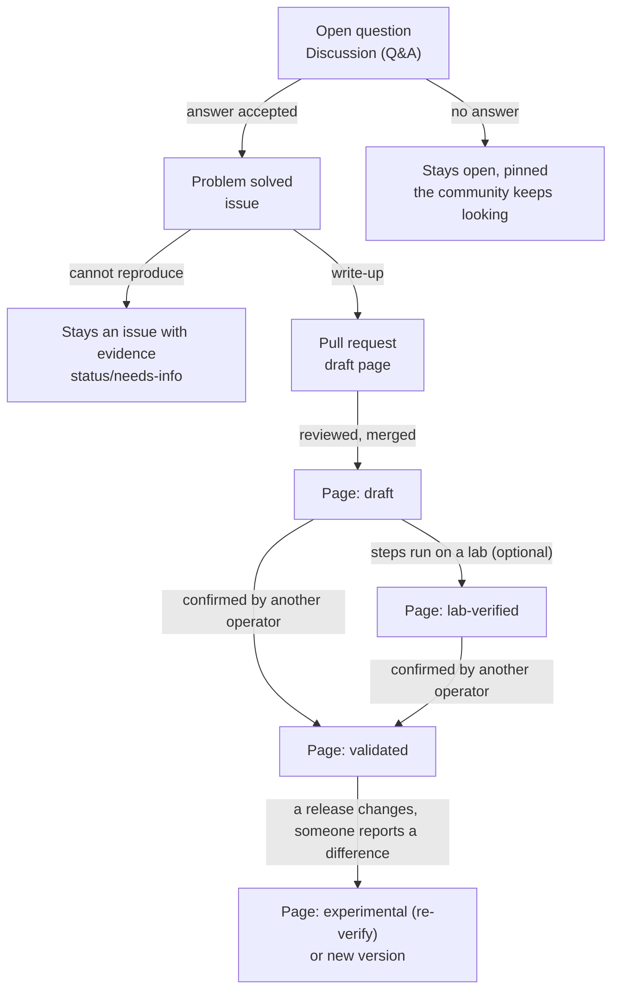

# Knowledge lifecycle

How a piece of operational knowledge moves from a question somebody asks to a procedure several operators trust,
and how the community tells the difference at every step.

## The states

| State | What it means | Where it lives | Label |
|---|---|---|---|
| **Open question** | Someone needs help. No confirmed answer yet. | Discussion (Q&A) or issue with the *Question* template | `status/open` |
| **Problem solved** | One operator fixed something and described how. Not yet checked by anyone else. | Issue with the *Problem solved* template, or a pull request | `status/candidate` |
| **Draft** | Written up as a page using the runbook or pattern template, under review. | Pull request, then a page marked `status: draft` | `status/in-review` |
| **Lab-verified** | Its commands were run on a lab platform (by a contributor or a lab agent) on a stated release and deployment method, and behaved as the page says. Not yet confirmed by an operator on a production platform. | Page marked `status: lab-verified`, with a `confirmed_by` entry of `type: lab` | `status/lab-verified` |
| **Validated** | Confirmed by at least one other operator in a different environment, or on a different release. | Page marked `status: validated`, with the confirmations listed | `status/validated` |
| **Experimental / needs verification** | Plausible but unconfirmed, or confirmed only under narrow conditions, or possibly outdated. | Page marked `status: experimental`, with what is uncertain spelled out | `status/needs-info` |

Experience reports and architecture comparisons do not go through validation: they describe what one team did and
why. They carry the author's context instead of a status, and others add their own perspective in the discussion.

## Page statuses

The four statuses a published page can carry, with the same wording on every OzarLand page that explains them:

| Status | What it means |
|---|---|
| `draft` | Written; its commands have not been run by anyone other than the author. |
| `lab-verified` | Its commands were run on a lab by someone other than the author, on the release stated in the page, and behaved as the page says. |
| `validated` | Confirmed by a human operator, other than the author, on a real platform. |
| `experimental` | Possibly outdated, or confirmed only under narrow conditions. |

Today (2026-10-24, counted with [`tools/coverage_report.py`](../tools/coverage_report.py)): **3 validated, 9 lab-verified, 21 draft,
0 experimental**, out of the 33 pages of the runbook and deployment-pattern repositories.

## The flow

## Rules that keep the states honest

1. **A solution is scoped, not universal.** Every page states the OpenStack release, the components, the deployment
   method and the environment conditions under which it was observed. "Worked for us" is a valid and useful
   statement; it is not the same as "works everywhere".
2. **A lab check is evidence, not validation.** A lab agent or contributor can move a page to `lab-verified` by
   running its steps on a lab and recording the release, deployment method and result. It fills in the releases
   on which the commands are known to work. Only an operator confirmation can make a page `validated`.
3. **Validation needs a second environment.** The author cannot validate their own page. A page becomes
   validated when another contributor reports, in the pull request or in a follow-up, that they applied it in a
   different environment or on a different release and it worked, or worked with a documented difference.
4. **Disagreement is content.** When two operators get different results, the page records both, with the
   conditions. The community does not vote on which one is true.
5. **Validity decays.** A page validated on one release is "experimental" on the next until someone confirms it.
   Reviewers may downgrade a page when a release changes the behaviour it describes.
6. **Unresolved is fine.** Open questions with no answer are kept visible. A list of things the community has not
   figured out is itself useful knowledge.

## Where each kind of exchange goes

| Exchange | Use | Not |
|---|---|---|
| "Has anyone seen this?" | Discussion, Q&A | An issue: there is nothing to fix yet |
| "I fixed this, here is how" | Issue, *Problem solved*, or directly a pull request with a draft runbook | A discussion only: it would get lost |
| "Here is how we deploy, what do you think?" | Discussion, *Show and compare*, then optionally a pattern page | A runbook: there is no symptom to resolve |
| "We upgraded from A to B, this is what happened" | Discussion, *Experience reports*, then an experience-report page (for Kolla-Ansible, in `version-notes/` of `kolla-ansible-deployment-patterns` until the upgrade repository exists) | A runbook: it is a narrative, not a procedure |
| "This page is wrong for release X" | Issue, *Documentation proposal*, on the page's repository | A new page: the existing one should carry the difference |
| "We should have a repository for Y" | Discussion, *Ideas*, in `ozarland` | Creating the repository: see [repositories.md](repositories.md) |

## Practical consequences for contributors

- Give context: release, deployment method, topology, backends, what you already checked. The templates ask
  for it because an answer without context cannot be reused.
- When you answer a question and the answer works, say so in the thread and open a *Problem solved* issue, or
  propose the page directly. Accepted answers that stay in a thread are the knowledge the community loses.
- When you apply someone else's runbook, report back. One sentence ("confirmed on 2025.1, Kolla-Ansible, OVN")
  is enough to move a page to validated.
- When you are not sure, say so in the page. "We believe the cause is X but did not confirm it" is more useful
  than a confident guess.
